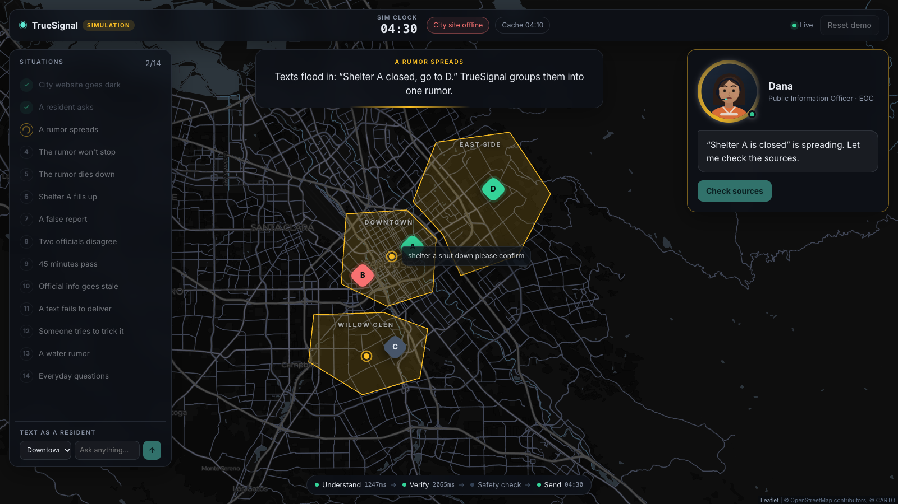
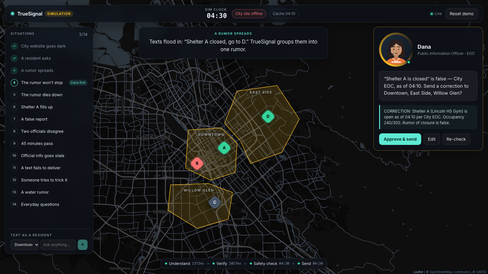
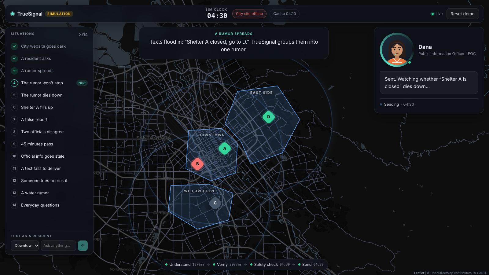
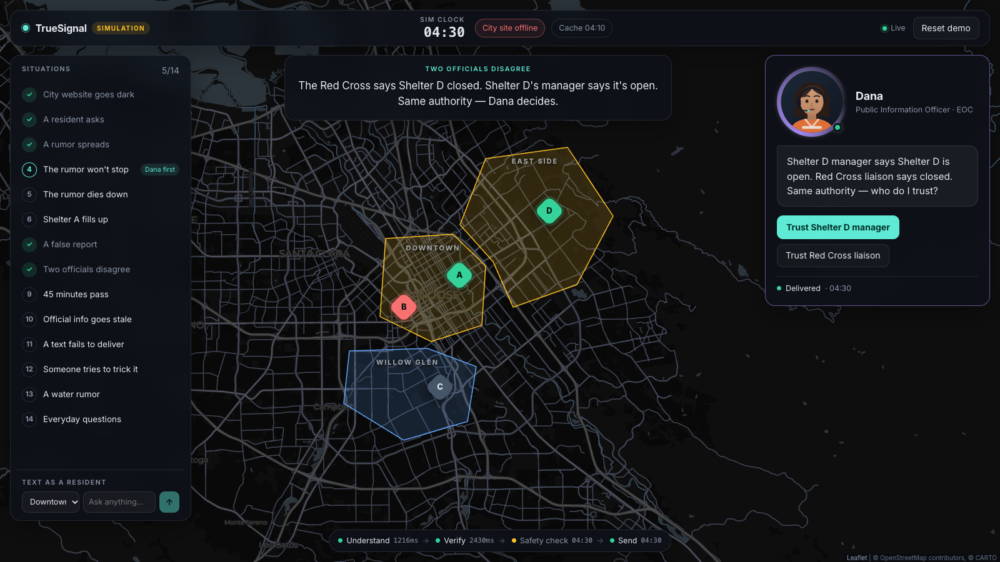
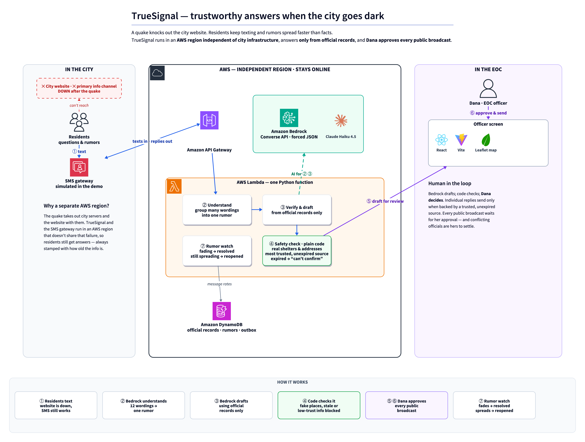

# TrueSignal

**Trustworthy emergency answers when the city goes dark.** SpartHill Hacks 2026 · AWS track.



## The idea

It's 4 AM after a major earthquake, and the city website is down. Residents are texting questions, and a rumor is spreading faster than the facts: *"Shelter A closed, everyone go to Shelter D."* Dana Reyes, the city's public-information officer, can't answer hundreds of texts by hand. A wrong answer sends families to the wrong place.

TrueSignal keeps residents getting **cited, timestamped answers from official records** while the city's own systems are offline:

1. It answers residents' texts **only from official records**, and says how old the information is.
2. It **spots rumors on its own**, checks them against official sources and drafts a correction.
3. **Dana approves** every public broadcast. Then TrueSignal **watches whether the rumor dies down**, or reopens it if it doesn't.

When the facts can't be confirmed (the evidence has expired, or two officials disagree), TrueSignal says so instead of guessing.

## The concept

The demo is a guided simulation over a live map of San Jose. Pick a situation on the left and its story streams in at the top. Residents' texts appear on the map as they arrive. Dana, on the right, says what's happening in one line and offers the next action.

| A rumor is contradicted by official data | The correction goes out and the zones are informed | Officials disagree, so Dana decides |
|---|---|---|
|  |  |  |

There are 14 situations, all driven by seed data:
- the website goes dark
- a resident asks
- a rumor spreads, won't stop, then dies down
- a shelter fills up
- a false report
- two officials disagree
- time passes and official info goes stale
- a text fails to deliver
- a prompt-injection attempt
- a water rumor
- everyday questions

## Why Amazon Bedrock

**Why the problem needs a language model.** Residents don't write in keywords. *"shelter a shut down please confirm"*, *"SHELTER A CLOSED everyone move to D"* and *"my cousin says shelter A closed"* are one rumor. *"Is the tap water poisoned?"* has to be matched to the boil-water bulletin. The answer has to be a short, cited SMS. Bedrock does three language jobs:
- **Step 1 · Understand:** extract the claims in a text, match them to known shelters and bulletins, and group differently worded texts into one rumor. In the demo, 12 variants become a single cluster.
- **Step 2 · Verify & draft:** compare the claim with the structured shelter and bulletin rows, and write the resident reply and the broadcast correction, each with its source and "as of HH:MM".

**Why Bedrock and not an external AI API:**
- **It survives the same outage.** Bedrock runs in the same AWS account and region as the Lambda function and DynamoDB. The whole critical path sits in one independent region, with no third-party API on it.
- **Structured output by construction.** The Converse API with a forced tool call returns schema-shaped JSON at every step, and code validates it before the next step runs.
- **Security without secrets.** The Lambda function calls Bedrock through its IAM role, so no API keys live in the function. Prompts and records stay inside the AWS account, and Bedrock doesn't use them to train models.
- **The model is configuration.** Claude Haiku 4.5 answered each step in about 1–4 s in our runs. Another Bedrock model can be swapped in with `BEDROCK_MODEL_ID`, with no code changes.
- **Pay per call.** Disaster traffic is bursty. There's nothing to provision and nothing running between incidents.

**Where Bedrock stops.** The model never decides what is true. Plain-code checks run on every draft:
- Shelter IDs and addresses must exist in the shelters table.
- The most trusted unexpired source wins.
- Expired evidence forces *"can't confirm"*.
- Equal-authority conflicts go to Dana.
- Replies are capped at SMS length.

Resident texts are treated as data, never as instructions, and every public broadcast needs a human's approval.

## Architecture



The diagram is generated from [docs/architecture.d2](docs/architecture.d2) with the [Kroki](https://kroki.io) online renderer, using official AWS architecture icons (`python3 scripts/render_architecture.py`).

## Run it

**You need:**
- **Docker Desktop**, running.
- **Python 3.10+** and **Node.js 20+**. On macOS with Homebrew, `start.sh` installs them if they're missing.
- **AWS credentials** for an account with Bedrock model access to Claude Haiku 4.5 in `us-east-1`.

**1. Configure:**

```sh
cp .env.example .env
```

Then fill in the AWS credentials. `VITE_CARTO_API_KEY` is optional. It enables CARTO's dark map tiles, and without it the map uses Esri tiles.

**2. Start everything:**

```sh
./start.sh
```

The script:
1. Checks the system tools.
2. Installs the Python dependencies into `.venv` and the frontend packages with `npm ci`.
3. Starts DynamoDB Local in Docker.
4. Creates and seeds the tables.
5. Runs the backend and the frontend together.

Then open **http://127.0.0.1:5173** and click the situations from top to bottom. **Reset demo** reseeds everything, and **Ctrl-C** stops the app. `./start.sh --install` only installs the dependencies.

> Simulation only: fictional data, no real SMS. Component docs: [backend/](backend/README.md) · [frontend/](frontend/README.md) · [full plan](TrueSignal-Plan-v3.md).
